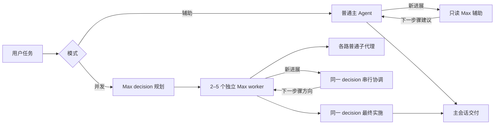

# DSH Ultra Mode

> **⚠ 黑箱展示与大幅 Token 消耗：请先了解再开启。** 并发 Ultra 的内部 worker、普通子代理及运行中 decision 不在主会话中逐路、逐步展示。用户主要看到最终交付阶段的 DSH 展示与结果，难以在界面中实时核对每一路做了什么。若宿主显示该阶段的思考，它取决于可见主 Agent 的请求与宿主呈现；插件不会逐字透传内部 decision 的真实思维链。
>
> **辅助模式保留普通主 Agent 的正常执行过程，只有旁路 Max decision 不逐步展示。** 它和并发模式的界面可见范围不同。
>
> **更多路线会明显增加 Token 预算。用户提供的粗略预算参考为：每多开一路，约增加 125%。** 这不是本插件测得的固定倍率；实际消耗随上下文、工具步骤、普通子代理及协调轮数变化，按钮没有额度或费用估算。

在 DeepSeek Harness 的会话输入框旁加入两个独立按钮：**协作增强（Team）** 控制子代理协作，**Ultra** 控制普通主 Agent 的自动决策辅助或 **2–5 条独立 Max 执行路线 + 1 条 Max 决策路线**。决策层会根据新进展反复检查、调整仍在运行路线的方向，最终统一实施与交付。每条独立 worker 仍能调用宿主普通子代理。

**最新已发布预发布版：[v0.4.0-rc.3](https://github.com/Kayou-31/dsh-ultra-mode/releases/tag/v0.4.0-rc.3)。目标宿主：DSH Desktop / Host 0.2.0-rc.2。** 原有稳定版 [v0.3.2](https://github.com/Kayou-31/dsh-ultra-mode/releases/tag/v0.3.2) 仍可选；其 [发布 CI](https://github.com/Kayou-31/dsh-ultra-mode/actions/runs/38151173809) 已成功：97 项通过、0 失败，另有 5 项实际 SDK 检查因公开 SDK 的运行时依赖不可用而跳过。跳过项没有算作通过，Windows 实际 SDK 的历史退出失败仍保留。

**v0.4.0-rc.3 修复工具栏空间并保留文字。** 输入框旁显示紧凑的「协作」与「Ultra 关／辅助／2–5」，常规总宽 132px，窄容器 96px。在本机约 720px 输入框中，两层同时开启仍完整显示原版模型名称；完整模式菜单和说明保留。[rc.3 验证记录](docs/verification-0.4.0-rc.3.md) 与 [修复 CI](https://github.com/Kayou-31/dsh-ultra-mode/actions/runs/38270844447) 可核对。

**v0.4.0-rc.2 新增独立的「子代理协作增强」开关。** Ultra 关闭时也可通过 `/team on` 让普通 Agent 使用后台派发、信息传递、续作、事件等待、中断和查询；`/team off` 关闭后续任务的协作，Ultra 选项保持原值。新增工具使用 `ultra_` 前缀，原生子代理工具保留。rc.1 首请求缺工具的失败已修复：rc.2 真实基础派发得到 210／56，主 Agent 的 97 合计 363；信息排队后同 ID 续作也已实际得到 46。基础任务保留一次等待参数越界拒绝及恢复，最终包重装后的新会话复核通过。[协作使用说明](docs/collaboration.md) 与 [rc.2 验证记录](docs/verification-0.4.0-rc.2.md) 记录行为与验收边界；本版已公开预发布，仍不是稳定版。

主分支现已补充完整中文文档、9 项案例工具检查，以及 4 个业务案例的 **66 项独立业务检查**。本机参考实现全部通过、缺陷基线全部被拒绝；这些结果不代表 Ultra 对业务任务的真实模型优势。[扩充验证记录](docs/repository-expansion-0.3.2.json) 与 [最新 CI](https://github.com/Kayou-31/dsh-ultra-mode/actions/workflows/verify.yml) 单独记录，不改写正式包的历史验收。

[安装指南](docs/installation.md) · [架构与配置](docs/architecture.md) · [协作增强](docs/collaboration.md) · [测试指南](docs/testing.md) · [业务样例](benchmarks/README.md) · [排障](docs/troubleshooting.md) · [更新记录](CHANGELOG.md)

## 快速安装

1. 下载已发布预发布版 [v0.4.0-rc.3 安装包 TGZ](https://github.com/Kayou-31/dsh-ultra-mode/releases/download/v0.4.0-rc.3/dsh-ultra-mode-0.4.0-rc.3.tgz)，用同版本 [SHA256SUMS](https://github.com/Kayou-31/dsh-ultra-mode/releases/download/v0.4.0-rc.3/SHA256SUMS-0.4.0-rc.3.txt) 核对。源码 ZIP 用于开发，安装请选择 TGZ。
2. 在 DSH 插件管理页的本地包安装入口选择该文件或填写其本地路径，安装并启用 `@dsh-external/dsh-ultra-mode` bundle。升级前保留 profile 配置与旧包，不覆盖原有 bundle 列表。
3. 完整退出 DSH（包括后台／托盘实例）后重新打开。在新会话输入框右侧检查 **协作（Team）** 和 **Ultra** 两个独立文字按钮。
4. 默认配置下，新会话协作与 Ultra 都关闭。只需要普通 Agent 协作时，用 `/team on` 并保持 `/ultra off`；需要额外决策辅助或并发时，再单独选择 Ultra 模式。随后提交普通任务，无需填写决策提示词。

发布包已含 `lib/`，用户不需要 Node 构建环境，也不需要复制 DSH SDK。不同安装入口或手动 profile 安装、升级与回滚步骤见 [安装指南](docs/installation.md)。该插件目前通过 GitHub Release 分发，不表示已发布到 npm registry。

需要原有稳定功能时可选 [v0.3.2](https://github.com/Kayou-31/dsh-ultra-mode/releases/tag/v0.3.2)；该版本没有新增协作开关。

## 使用与模式

| 选择 | 执行者与思考设置 | 决策职责 | 普通子代理与交付 |
| --- | --- | --- | --- |
| 关闭 | 普通主 Agent，保留 DSH 设置 | 不自动加入 Ultra 决策 | 按宿主原有行为执行 |
| Agent + 决策 | 普通主 Agent，模型、provider、preset、思考强度及权限不变 | 额外 1 条只读 Max 辅助，根据进展提供建议 | 主 Agent 负责子代理、工具、写入和最终交付 |
| 2／3／4／5 路 | N 条独立 Max worker；数量不含 decision | 1 条 Max decision 共用上下文完成规划、运行中协调和最终实施 | 各 worker 可派普通子代理；主会话呈现最终交付，避免重复实施 |

并发 worker 负责研究，默认不允许写入、命令或发布；共享工作区的修改由 decision 最终阶段处理。没有自动创建每路 Git worktree。辅助模式的旁路 decision 只读，主 Agent 的原有执行权限保持不变。

默认配置下，新会话的协作增强与 Ultra 都关闭，首次开启并发默认 **3 路**。选项按会话隔离；运行中修改只影响后续任务，重启 DSH 后按配置重新初始化。按钮和菜单使用实色背景，不修改滑轨或思考强度选择器。

| 命令 | 行为 |
| --- | --- |
| `/ultra assist` 或 `/ultra 1` | 普通主 Agent + 只读 Max 决策辅助；`1` 不是一个 Max worker 接管任务 |
| `/ultra 2`、`/ultra 3`、`/ultra 4`、`/ultra 5` | N 条独立 Max worker + 1 条 Max decision |
| `/ultra on` | 恢复当前选择；新会话首次开启默认 3 路 |
| `/ultra off` | 关闭后续任务的自动 Ultra，保留已选模式 |
| `/team on`、`/team off`、`/team` | 独立管理或查询后续任务的子代理协作增强，不改变 Ultra 算力模式 |

按钮关闭时，用户明确要求的手动并发 Ultra 可通过 `ultra_task` 入口处理。内部路线和它们的子代理不能递归开启 Ultra。

## 调度如何工作

反馈通过宿主下一模型步骤通道处理，不能改写已经发送的模型请求。**入队、持久准入和实际采纳是不同证据。** 协调只在新进展时运行，没有空轮询；默认可反复触发，仍受本次任务的取消与超时控制。完整协议、权限、收尾和轮数预算见 [架构与配置](docs/architecture.md)。

## 已验证什么

| 证据 | 已证明 | 重要限制 |
| --- | --- | --- |
| v0.3.2 发布与 CI | 正式 Release；发布 CI 构建、类型检查成功，97 通过／0 失败／5 跳过 | 公开 SDK 的运行时依赖不可用，不能用跳过代替集成验收 |
| rc.2 真实普通 Agent 协作 | 首请求六工具；2 个 depth 1 子代理继承 High；210／56／97 合计 363，2 次成功等待含 cursor；续作任务实际得到 46 | 一次 120000 毫秒等待被 0–60000 范围拒绝后恢复；续作账本独立核对通过，最终包重装的新会话复核通过，工具错误为 0 |
| v0.3.2 真实两路 | 两个独立 Max worker 各完成一个普通 Max child，结果 14／30；正常审批后唯一写入、10 行读回与实际文件一致 | 3 次协调均为空方向；这次短任务没有证明新改向采纳，也未触发格式 repair |
| v0.3.2 真实辅助 | 主 Agent 保持一个 turn；普通 child 得到 140；同一只读 Max 辅助 7 条建议在原 turn 准入，并核对具体采纳行为 | 记录选写 2 条，不把 7 次准入当 7 次正确采纳；建议超验收的 80 字要求，一项存在性检查时序偏差保留 |
| 历史 3／4／5 路真实任务 | 独立 Max 路线、普通子代理和跨路协调有实际宿主证据；0.3.0 长任务核对 17 条方向准入 | 只独立核对部分具体采纳；历史越界读取尝试及后台 child 晚到边界保留 |
| 实际 SDK 离线场景 | 工具限制、审批桥、同 turn 反馈、格式 repair、取消与清理等契约 | 模型与部分工具回复来自脚本 adapter，不能代表真实业务质量；Windows 全 SDK 子进程历史退出失败未改记成功 |
| 新业务 fixture 与扩展测试 | 为可复现任务、协议检查及评测提供输入、参考结果和运行说明 | 未经真实模型／人工评审的业务 fixture 不能声称模型质量已验收；其最新覆盖与命令见测试及业务样例文档 |

v0.3.2 正式包的 23 个编译文件与真实验收包 `701fbd1b` 阶段逐字节一致；正式 TGZ 整包哈希本身没有被真实模型实测。原始 provider 请求正文未留存，不能称为抓包验证。真实任务由用户在 DSH 中运行后核验日志及文件；完整 DSH 原生界面自动化控制未获验证。Jev 真实账户、重复长任务、未来宿主版本与业务质量泛化仍未验证。

详细证据按版本保留：

- [rc.2 预发布验证](docs/verification-0.4.0-rc.2.md)：记录真实基础派发和实际续作链、等待参数错误及恢复，最终包重装的新会话复核通过，工具错误为 0。[rc.1 离线阶段记录](docs/verification-0.4.0-rc.1.md) 的统计与后续首请求失败继续归属 rc.1。
- [0.3.2 验证记录](docs/verification-0.3.2.md)、[最终真实摘要](docs/real-model-0.3.2-final-summary.json)、[SDK 聚合摘要](docs/sdk-verification-0.3.2.json)。历史记录中的“准备发布”是写入当时状态，当前正式发布状态以首页和 Release 为准。
- [首候选失败](docs/real-model-0.3.2-candidate-summary.json) 与 [修复阶段复验](docs/real-model-0.3.2-recheck-summary.json)：保留审批超时、非法 JSON、缺 child 等历史失败。
- [0.3.1 未发布历史](docs/verification-0.3.1.md)、[0.3.0 验证](docs/verification-0.3.0.md)、[0.2.0 验证](docs/verification-0.2.0.md)、[0.2.0 真实模型记录](docs/real-model-0.2.0.md)。

## 常见问题

**Ultra 是否对应模型 API 的新思考强度？**

请求仍使用宿主支持的 `reasoningEffort: max`。Ultra 增加并行研究和独立决策，没有向 API 发送虚构的 `ultra` 强度，也不声称复现 Codex 内部实现。辅助模式主 Agent 保留原先选择的强度。

**为什么 worker 还可以派子代理？**

worker 使用独立 AgentLoop，本身不算普通子代理，不占一层委派深度。它们调用的普通子代理仍受 DSH 的权限、能力和深度限制，插件不会无限放开嵌套。

**为什么看不到每路的实时全过程？**

当前主会话展示最终交付，内部路线有宿主审计记录但不逐路展示。辅助模式保留普通主 Agent 过程；旁路 decision 仍不可逐步查看。可见思考不能当作内部 decision 原始思维链。

**决策层是否只在最后审查？**

并发模式共享一个 decision 上下文完成规划、进展协调、最终交付；辅助模式在普通主 Agent 运行期间提供建议。短任务可能在建议可消费之前结束，入队也不保证采纳。

**必须使用 Jev 或填写自己的决策提示词吗？**

默认使用内置 Max 决策提示词。Jev 是并发模式的可选最终辅助判断，默认关闭，辅助模式不调用 Jev。开启后会向配置服务发送受限任务与报告摘录，见 [Jev 配置与数据范围](docs/architecture.md#可选-jev)。

**主仓库和 Release 有什么区别？**

主仓库保存当前源码、文档、测试与业务样例；Release 发布特定版本的可安装包和哈希。主仓库新增文档或测试不会自动改写已经上传的 TGZ。安装用 Release TGZ，开发用源码；最新仓库验证状态见 [测试指南](docs/testing.md)。

## 参与与支持

[贡献指南](CONTRIBUTING.md) 说明开发与验证约定；问题可使用 [Bug 模板](https://github.com/Kayou-31/dsh-ultra-mode/issues/new?template=bug_report.yml) 或 [功能建议模板](https://github.com/Kayou-31/dsh-ultra-mode/issues/new?template=feature_request.yml)。提交前请移除密钥、个人路径、会话身份与原始思维链；敏感问题见 [安全报告约定](SECURITY.md)。

本项目采用 [BSD-3-Clause](LICENSE) 许可。
