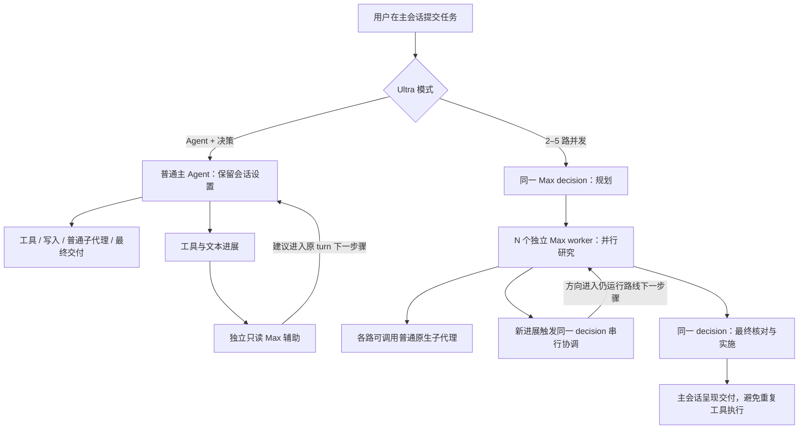

# 架构、配置与运行边界

本页描述原有 v0.3.2 调度及 0.4.0-rc.2 候选源码的协作增强，目标宿主为 **DSH Desktop / Host 0.2.0-rc.2**。安装与日常操作见 [安装指南](installation.md)、[首页](../README.md) 和 [协作使用说明](collaboration.md)，当前候选状态见 [rc.2 验证记录](verification-0.4.0-rc.2.md)：真实基础派发与续作执行链已走通，保留一次等待参数拒绝及恢复；最终包重装的新会话复核通过，工具错误为 0。历史验证范围见 [0.3.2 记录](verification-0.3.2.md) 与 [最终真实验收摘要](real-model-0.3.2-final-summary.json)，不作为新增协作的真实模型验收。正式发布状态仍以 [v0.3.2 Release](https://github.com/Kayou-31/dsh-ultra-mode/releases/tag/v0.3.2) 为准。

## 独立的协作增强

Ultra 算力模式和子代理协作分别使用 `enabled` 与 `collaborationEnabled` 开关。`/team on|off` 或会话协作选项只改变后续任务的协作选择，`/ultra` 保持原有模式控制；两者可分别使用，也可一起开启。只开启协作时，普通主 Agent 保留模型、思考档位、工具和交付职责，不自动创建 Max decision。

新增六个 `ultra_*` 工具通过 DSH 公开 continuation 服务派发和续接正常子代理，继承宿主深度、容量、工作区与审批限制，保留原生子代理工具。每组有独立账本和有界邮箱；`ultra_send_message` 不唤醒空闲目标，`ultra_followup_task` 显式续作，事件等待支持 cursor 防重复。组内直接父子可互发信息，父 Agent 可以中断自己创建的后代；代理消息不增加用户授权。协作组随当前 turn 或 Ultra 路线收尾，运行中切换选项不修改正在执行的组。

rc.2 在主 Agent 的 `turn/start` 预挂载协作工具，早于首请求组装；连续任务还在 `system-prompt/assemble` 等待前组收尾，必要时通过公开接口重建完整请求材料。修复后真实基础任务的首请求 header 已包含六个工具，并核对两个增强子代理继承 High、委派深度 1；请求材料证据不称作 provider 网络正文抓包。等待工具已补充 0–60000 毫秒范围、默认 30000、目标数量及 cursor 文案，最终文案包另行重装复验。

每个协作子代理有自己的会话上下文，仍访问共享工作目录，没有自动创建 worktree。Ultra worker 的研究权限继续约束其协作子代理。完整工具、容量和证据边界见 [协作使用说明](collaboration.md)。

## 两条任务路径



图中的箭头表示调度与反馈关系，不代表只有一次 API 请求。worker 是独立 AgentLoop，不是普通子代理；它们保留宿主原有委派规则，插件不会提升宿主允许的子代理嵌套深度。已经发送的模型请求不能被改写，反馈入队也不等于已准入或已采纳。

## 代码入口

| 文件 | 职责 |
| --- | --- |
| `src/index.ts` | 插件入口、会话事件、命令及自动任务接入 |
| `src/ultra.ts` | Ultra 选项、会话状态与配置边界 |
| `src/orchestrator.ts` | 并发任务规划、路线执行、最终交付与清理 |
| `src/coordination.ts` | 进展快照、跨路协调与方向协议 |
| `src/assist.ts` | 普通主 Agent 的只读决策辅助及反馈生命周期 |
| `src/runtime.ts` | DSH SDK 桥、工具权限、审批及原生子代理观察 |
| `src/collaboration.ts` | 协作身份账本、有界邮箱、续作、等待、cursor 与组内生命周期 |
| `src/collaboration-host.ts` | 原生 continuation 服务适配、六个协作工具与来源标记 |
| `src/jev.ts` | 可选 Jev 请求与响应校验 |
| `src/client/index.ts` | 输入框按钮、实色菜单与会话列表兼容桥 |

## 主 Agent 辅助模式

主 Agent 继续使用会话实际选择的模型、provider、preset、思考强度及工具权限，负责工具执行、写入、子代理和最终交付。辅助模式不会把主 Agent 强制改成 Max，也不会让主 Agent只转述辅助路线的答案。

插件为真实用户任务自动加入独立的 Max 决策辅助。辅助路线只做只读判断，在任务运行中观察进展，向主 Agent 提供可反复更新的方向建议；它不负责最终实施、写入或发布。建议由主 Agent 在后续模型步骤处理，已经发出的模型请求不会被中途改写。辅助绑定当前用户任务的主 Agent turn，完成或取消后停止，不为补建议额外唤醒主 Agent。主 Agent 不进入并发模式的交付转述限制，原生子代理仍按 DSH 原有工具和委派规则调用。

辅助创建后立即进行一次初始检查，此后主 Agent 的工具返回、完整助手文本和本次新建原生子代理的进展触发建议；限频串行，没有新进展时不轮询。建议只送往仍在运行的原主 turn，入队不等于主 Agent 已采纳。主 turn 结束、下一 turn 开始、取消、超时或卸载都会停止辅助接收并清理 decision；辅助不会替主 Agent 发起新 turn。辅助模式不调用 Jev，也不另做最终代写。

辅助收尾立即停止接收与决策请求，再等待本次运行仍待消费的反馈清理完成，保留人类消息、其他运行消息和已准入历史；清理异常如实报告。达到有限轮数上限只停止新决策请求，当前建议仍可在原 turn 消费，最终随主 Agent 生命周期清理。

辅助最终回复须符合单个严格 JSON 对象协议；解析错误会保留。主 turn 仍活跃且预算足够时，同一 decision 上下文最多做一次格式修复，修复只收到具体错误和格式要求，不把旧非法全文当成指令；再次失败不入队，也不无限重试。修复也消耗一次 `decision.run` 调用预算，不增加逻辑协调轮计数。

| 对比 | 主 Agent 辅助 | 2 / 3 / 4 / 5 路并发 |
| --- | --- | --- |
| 实际任务执行 | 普通主 Agent，保留会话设置 | 独立 Max worker 研究，decision 最终实施 |
| 额外决策 | 1 条只读 Max 辅助 | 1 条 Max decision，规划、协调与最终实施共用上下文 |
| 文件写入、命令、发布 | 主 Agent 按原有权限处理 | worker 研究阶段禁止；decision 最终阶段统一处理 |
| 子代理 | 主 Agent 保持原生能力 | 每个独立 worker 保持原生能力，不因 worker 身份占一层深度 |
| 主会话交付 | 主 Agent 自行执行与交付 | 主会话呈现 decision 的交付，不再重复实施 |


## 并发模式运行机制

1. 新建一个独立 decision loop，以插件内置的决策提示词和 Max 规划任务并分配 N 个研究方向。规划只接受单个 JSON 对象、唯一 `assignments` 字段、与路线数相符的非空字符串数组；不从叙述或多个对象中选取片段。格式失败时同一上下文最多修复一次，再失败或修复请求失败则按稳定路线索引降级，保留用户指定的每路动作并公开错误。首次 provider 请求失败仍终止任务，不伪装为可用规划。默认不依赖 Jev，也不用用户填写提示词。
2. N 个独立 worker loops 并行工作。它们继承主会话的模型、provider、preset 和已完成轮次的上下文，固定使用 Max。它们不是 `subagents.start()` 创建的子代理，也不消耗一层委派深度；每一路仍可调用宿主正常的子代理工具。
3. 并发运行期间，工具返回和完整助手消息形成有界进展快照。原来的 decision loop 按事件串行审查各路进展，发现重复、分歧或新线索时向仍在运行的路线发送方向调整。指令通过宿主原生 `Agent.steer()` 进入下一模型步骤，并记录在该路线日志中；已发出的请求无法中途改写。没有新进展时不轮询，短任务结束后不补协调轮。默认最短间隔 1 秒，不限协调轮数，但仍受本次 Ultra 的超时和取消控制。
4. 同一个 decision loop 收到最终报告，核对冲突、实施变更、验证并形成交付。规划、运行中协调和最终交付共用上下文，decision 自身不重叠运行。
5. 主会话呈现结果。宿主守卫禁止该轮主会话再调用工具重复实施；新的实际用户输入恢复任务处理；若在上一任务呈现期间进入同一 turn 的 next-step，也会顺序启动独立 Ultra，不沿用上一任务的转述限制。

**执行策略：**并发 worker 负责读取、搜索、推理、提出实现方案和调用研究子代理；共享文件的写入、命令执行和发布由 decision 收敛阶段统一执行。当前版本没有给每个 worker 自动建立 Git worktree，因此不让多路同时修改同一份工作区。研究工具 allowlist 是配置项；追加有副作用的工具会改变这个边界。

研究阶段强制 native 工具呈现，支持父会话的 native / ptc / both 模式，并继续禁止任意 JavaScript 的 `run_code`。继承工具的可见 schema 与研究 allowlist 对齐，避免模型先规划命令、调用时才被拒绝；宿主必须保留的 agent 自有工具仍受执行守卫约束。decision 运行中协调保持研究权限，最终实施阶段才恢复父会话实际工具呈现和权限。审批保留实际调用路线的审计身份，通过可见主会话接受；人机问题也转发给主会话。

内置提示词明确区分推理和实际运行验证，不为原任务添加“必须执行命令”等额外条件。宿主观察到的普通子代理 ID 随路线报告传给 decision，弥补等待式 `subagent` 返回体没有 ID 的可观测性缺口；这些身份只证明创建，完成状态和结果仍须核对实际工具返回或会话记录。取得非空完成报告不代表业务任务成功。

用户要求某一路真实派子代理时，其他路线或父路线自行算出的正确数值不能替代该子代理的实际创建与完成证据。规划、降级或最终收敛均须保留这个区别。

内部路线有独立、持久化的 DSH 审计日志，但不在普通会话列表中展示。客户端使用针对 0.2.0-rc.2 的会话列表兼容桥，仅过滤 `ultra-route-` 前缀的内部记录，不改原快照或子代理 origin；卸载恢复原读取函数。升级宿主版本前应重新验证这条桥。

主会话接收的是内部交付的文本结果，不是内部 decision 思考内容的逐字记录。持久化审计日志与主界面逐路可见性是两件事：日志存在不能写成用户能在会话框中实时看见各路全过程。

## 配置

bundle 已提供默认 patch。需要覆盖时，在用户 profile patch 中按相同 `id` 更新，例如：

```yaml
- id: ultra-mode
  config:
    concurrency: 3
    timeoutMs: 900000
    reportChars: 20000
    jevEnabled: false
```

| 配置 | 默认值 | 含义 |
| --- | --- | --- |
| `concurrency` | `3` | `1` 表示主 Agent 辅助；`2`、`3`、`4`、`5` 表示相应并发 worker 数，不含 decision |
| `collaborationEnabled` | `false` | 新会话协作初始选择，独立于 Ultra 算力开关 |
| `collaborationProvider` | `spawn` | 新协作派发使用的宿主 continuable provider |
| `collaborationMaxAgents` | `8` | 每个协作组的子代理登记上限，1–32；宿主深度及活动容量限制同时有效 |
| `toolName` | `ultra_task` | 手动入口工具名称 |
| `timeoutMs` | `900000` | 一次运行截止时间，毫秒 |
| `reportChars` | `20000` | 传入 decision 的每路报告字符上限 |
| `coordinationIntervalMs` | `1000` | 运行中决策轮的最短启动间隔；仅新进展触发，无空轮询 |
| `coordinationMaxRounds` | `-1` | `-1` 不限。并发模式的正数限制逻辑协调轮数，`0` 关闭运行中协调但保留规划与最终决策；辅助模式的正数限制 `decision.run` 调用预算（格式修复也消耗一次），`0` 仅允许一次初始检查、不会修复 |
| `maxSessions` | `64` | 内存中的会话设置 LRU 上限；不淘汰运行中的状态 |
| `researchTools` | 读取、搜索及子代理工具 | 研究路线和后代的工具 allowlist |
| `jevEnabled` | `false` | 开启并发模式的额外 Jev 最终判断；主 Agent 辅助模式不调用 Jev |
| `jevKeyEnv` | `TYPESAFE_API_KEY` | 仅由 Host 环境读取的密钥变量名 |
| `jevModel` | `jev-latest` | TypeSafe Jev 模型名 |
| `jevBaseUrl` | `https://api.typesafe.ai` | Jev API 服务地址 |
| `jevTimeoutMs` | `15000` | Jev 请求截止时间，100–120000 毫秒 |

Ultra 按钮与命令共用现有 `enabled` 和 `concurrency` 状态，不增加 `mode` 字段：`concurrency=1` 为辅助，`2..5` 为并发，`enabled=false` 为关闭。`/ultra off` 保留当前选项，`/ultra on` 恢复它；协作使用独立的 `collaborationEnabled` 状态及 `/team` 命令。开关和选项只驻留 Host 内存，重启后按配置重新初始化。内部审计日志仍遵循 DSH 的持久化行为；“状态不持久化”不表示任务文本不会写入宿主日志。

辅助的有限预算约束 `decision.run` 调用数；一个 run 内仍可能有多次模型请求或工具步骤，不是底层 provider 请求数上限。辅助的协调摘要 `rounds` 统计逻辑检查轮数，单轮格式修复不会再加一轮，因此它可能小于实际 run 调用数。上限为 1 时只做初始 run，没有格式修复。

## 可选 Jev

适配的是 [TypeSafe 的 Jev API](https://api.typesafe.ai/redoc)，调用 `/v1/systemone`，比较并发模式的各路报告、返回路线选择和证据充分性概率。它属于 decision 的辅助判断，不能替代 DSH 的工具执行循环，也不增加一条执行路线。主 Agent 辅助模式不调用 Jev。

开启 `jevEnabled` 并给启动 DSH 的进程提供 `TYPESAFE_API_KEY`。开启后，任务及有效分支报告的受限摘录会发送到配置的 Jev 服务（任务最多 4000 字符，每路最多 8000 字符，截断会标记）。密钥不进入按钮 RPC、日志结果或分支正文。缺密钥、超时、HTTP 错误或无效响应会明确降级为内置的 DSH Max decision。运行中跨路协调由 DSH decision 实现，Jev 只用于最终报告的可选辅助判断。

这不是 npm 发布，也没有捆绑 Jev 模型权重。本次未提供 Jev 实际账户密钥，验证使用离线官方协议 fixture，没有真实 Jev 服务调用证据。

## 失败和清理

- 并发模式至少需要 2 条非空、完成的报告才会进入最终 decision；缺少报告会明确显示。报告计数不等同于任务成功数，返回的拒绝或失败说明须由 decision 如实保留。
- 并发模式 decision 失败只保留分支证据，标记尚未完成交付。辅助模式的建议失败不将主 Agent 的任务改为已交付，也不替它执行或重开任务。
- 同一会话不重叠启动独立 Ultra 任务。并发模式避免两个最终实施者同时写入；辅助模式保留主 Agent 的正常执行职责。
- 并发模式的用户取消、超时和插件卸载会取消并等待实际内部路线及其子代理退出；既有并发卸载与 drain 具有历史离线宿主测试。辅助模式清理自己的 decision，不由辅助额外取消或唤醒主 Agent；同 turn 反馈与结束已有真实模型证据，未消费反馈清理和有限预算的边界仍主要由独立实际 SDK 离线场景验证。
- 路线清理不会删除 DSH 的持久化审计日志。卸载本插件后，保留的内部日志可能重新出现在原生列表中。

## 消耗

并发模式的 N + 1 指活跃的独立路线数量，不代表只发 N + 1 个 API 请求。decision 至少有规划、收敛两轮，worker 可以多步用工具和子代理，主会话还有呈现请求；报告与上下文也会重复发送。辅助模式保留主 Agent 的请求，并额外发出独立 Max 辅助请求；反复建议会增加请求与上下文消耗。实际 Token、时间和配额消耗随任务变化，按钮没有额度估算。

开头的“每多一路约增加 125%”仅供粗略预算，来源为用户提供的参考，不是本插件的计量结果或固定计费规则；不能据此推算确定费用。

## 兼容性与证据边界

宿主 peer 为 Cordis `~4.0.4`、Schemastery `~3.18.4`、DSH agents/tools/llm/session/scope `0.2.0-rc.2`；Web 客户端使用同版本 UI renderer、connection、locale、session-controller，以及 React 18/19。开发与业务案例使用 Node.js 24，与 CI 保持一致。没有宣称兼容旧 0.1.x API，未来宿主版本升级需重新检查会话列表桥和 SDK 契约。

内部路线有持久日志不等于 GUI 展示全部过程。主会话只接收内部交付的 text，不能把主 Agent 的可见思考称为内部 decision 的原始思维链。模型输出正确、任务 completed、报告非空、子代理已创建分别证明不同事实；要求真实子代理结果时必须核对实际创建、完成和返回文本。

已发布版本的真实运行与离线 SDK 证据见 [验证记录](verification-0.3.2.md)、[SDK 聚合摘要](sdk-verification-0.3.2.json) 和 [最终真实摘要](real-model-0.3.2-final-summary.json)。新业务样例见 [benchmarks](../benchmarks/README.md)，测试命令与证据分层见 [测试指南](testing.md)。离线业务 fixture 的结构或答案校验不能证明真实模型在该业务上的质量。
