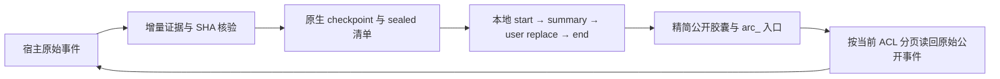

# Ultra 持久证据与上下文管理

> 0.7.0 新增工程记忆与主动进度查询；最新功能、默认开关和证据边界见 [Memory README](../packages/dsh-ultra-memory/README.md) 与 [0.7.0 发布报告](releases/0.7.0.md)。下文 OCG、rc.2 实验与“本轮”措辞属于 0.6.0 历史文档，不计入新版本验证。

本页说明当前完整 Ultra、独立 Memory 和 Decision 共用的证据底座；包路径及组合见[附属插件](companion-plugins.md)，安装见[安装与回滚](installation.md)。本轮主验收宿主为官方 DSH **0.2.1-rc.2**，旧 **0.2.0-rc.2** 的 SDK／原生回归单列，不将声明兼容范围当作全部能力实测。OCG 结果、原生／模拟／真实模型分层及失败记录见[本轮实验](OCG-EXPERIMENTS.md)，本轮没有安装到日常环境。历史 0.5.0-rc.3／naizhi 成绩保留在[原验收报告](evidence-verification.md)，不作为当前构建成绩。

## 使用

仍使用原来的 Ultra 按钮和命令：关闭、Agent＋决策辅助、手动选择 2～5 路。不会根据任务自动提高并发，不会为建索引启动模型、embedding 或外部数据库。持久证据、状态、检索、路线入口与压缩机制已整合在本插件，运行不依赖另装 billion-context-dsh 等记忆插件；也不能让两个压缩管理者接管相同历史。Jev 默认仍关闭。辅助模式主 Agent 的模型、权限与执行职责保留；研究 worker 与辅助 decision 保持只读。

已启用的证据权威在有绝对项目 cwd、持久日志读取和 checkpoint 能力时建立证据运行；独立 Memory 可用于普通主 Agent，不必开启 Ultra 多路线。缺少能力时显示不可用；已有活动归档则停止后续请求，不能绕过恢复要求。证据工具在插件注册，但无项目／会话绑定的调用在执行器内被拒绝；工具名本身不赋予访问权限。

模型可使用：

```text
ultra_memory_search({query:"早期限制",file:"config.ts",routeId:"...",maxChars:4000})
ultra_memory_get({id:"src_...",offset:0,maxChars:6000,neighbors:1})
```

search 还支持来源／分块／语义 ID、主题、时间范围、分页和条数；get 支持来源、分块、语义和状态版本的预算内分页。结果包含真实来源、覆盖状态；语义结果还区分 current / superseded / unresolved。摘要没有答案时，原文关键词索引仍可独立查找。源文件不再可读或校验变化时返回缺口，而非用摘要伪装原文。

worker 的宿主进展和最终报告附带证据 ID。decision 能自行检索兄弟路线的证据。报告末尾可用 `ultra_evidence` JSON 块提交已有结论的候选分类、主题、冲突、替代关系与状态；它复用当前报告调用，不增加模型轮次。错误块保留诊断，不能通过写索引扩大权限。模型整理的事实明确标注“未独立复核”；模型声称执行／验证的操作降为计划候选。宿主实际收到的非错误工具返回记为 executed，**不表示任务效果已 verified**。

菜单详情及无障碍状态提供：阶段、各路状态、原文与语义登记数量、覆盖类型、检索次数、未解决冲突、最近压缩前后预算、观察到的调用／token，以及未知用量。无原始私有思维链展示。

## 数据与权威来源

项目目录中自动创建：

```text
.dsh-ultra/v1/
  records/                 # 校验封装的来源、语义和项目状态版本
  owners/                  # 根会话与路线归属、增量扫描游标
  archives/arc_<hash>.json  # 可选旧阶段归档清单；公开原文仍在宿主日志
  ledger/<run-hash>/       # 每次请求观察与结算用量，独立原子记录
  exports/<root-hash>/
    index.md               # 目录、状态、来源、语义索引
    topics/*.md            # 主题派生视图
    run-<hash>.json         # 本轮状态与资源快照
```

宿主 append-only 会话日志是原始会话的权威；`records/` 是插件来源定位、索引、语义关系及状态版本的权威。Markdown 只是单向派生视图，编辑它不会回写或覆盖结构化记录。不要将 `.dsh-ultra/` 提交到公开 Git 仓库；它可能含用户要求、工具输出和文件引用。插件不会替你提交这些资料。

来源 ID 含 project / run / session / route / event / version 身份，分块有稳定范围和 SHA-256。原文和每块均有校验。一个来源可以有多个主题、文件及语义关联；旧决定保留，通过替代关系显示旧状态。覆盖数量与语义条数分开：登记了原文不表示模型已经提炼完整。

已存在的宿主正文只保存定位、分块范围、词项和校验，不复制所有历史。工具结果先在 `tools/execute` 返回边界、宿主 `projectContent/post-execute/finalizeContent` 保留策略之前捕获可访问的公开渲染文本；PTC 的日志边界单独观察。此时完整输出可能尚未持久化，因此临时保留 captured 正文。checkpoint 后宿主全文校验一致才原子转为 host 引用并释放临时正文；保留策略改变了文本时继续保留捕获版并记录覆盖差异。

工具自身的 execute/render 已经剪掉的字节、未被宿主暴露的会话、不可读附件不在完整性保证内。图片和文件只记录有效附件 ID／引用，不伪装成已提取的全文。只索引公开 text，忽略 reasoning、thinking、provider 私有流和工具私有 presentation meta。资源计量仅读取 usage 字段或 usage 帧。

索引采用本地文件原子替换、写入 fsync、短锁、稳定身份去重和完整性检查。临时半写文件记入覆盖诊断；已提交记录损坏则拒绝使用该权威库，保留原始宿主日志供修复。初次扫描分页；以后从扫描游标处理新增事件，按需读取历史窗口。恢复根／路线权限必须重新验证实际宿主 header 的 cwd 和从根出发的完整 lineage，不能信任调用参数或仅信任归属文件。

## 上下文与压缩

### 报告与精确引用（rc.3）

研究 worker 在本路线运行期间可调用 `ultra_submit_report`，提交有界 text、evidenceIds、unknowns、conflicts。宿主验证其为当前只读 worker，证据属于已授权原文，并以原生 `concludeTurn` 完成；只有原生 completed 且未取消才采用。主 Agent、decision、普通后代没有这个报告权限。报告可省略语义提炼，原始证据仍独立增量索引。要求纯 JSON／固定格式时不追加 Markdown 元数据块。

规划阶段只分配已知任务，不读取资料：实际请求 tools 为空，执行器同时拒绝该路线和后代工具。研究阶段仍只读，最终 decision 恢复原有宿主权限。四个阶段 maxTokens 可显式配置，默认 0 继承；不会静默降低 Max、自动重试或启动额外路线。模型也可能在任何有限 cap 内耗尽推理预算，报告工具减少最后一次自然语言收尾请求，不能保证所有任务成功。

`ultra_memory_get({id:"src_…",quote:"连续原文",maxChars:12000})` 在 ACL 与原文校验后返回 `citation`，包含 sourceId、quote、字符 start/end、SHA256 和可选 origin。sourceId 是证据定位，origin.resourceId 是实际工具调用参数请求的资源 ID；它不证明第三方重定向后的规范名称。正文内部 A-/B-标签不能据此当作 vendor-a/vendor-b 等实际工具参数中的公共资源 ID。quote 必须属于所选范围，预算不足明确拒绝，不剪短已验证引文。语义条目／状态不是原文引文。校验说明出处与字节一致，不证明内容事实正确或增加授权。

长 JSONL 的整行核验要区分分块和原文范围：search 的 `start/end` 是来源中的分块范围，`chunk_` 的 get 只在所选分块／相邻范围内读；全来源偏移应配返回的真实 `src_` ID 使用。跨分块的整行先按 `src_` 分页读完整，再提交逐字 quote。`maxChars` 限制整个返回 JSON，含 text、citation 和重复引文，不是可返回引文的净长度；预算不足应提高到配置允许值或拆分读取，不能删掉验收必需字段后冒充整行。`nextOffset` 是续页入口，不代表目标事实已经找到。第11阶段实际误用和守卫拒绝见[实验记录](OCG-EXPERIMENTS.md)，不将工具拒绝掩盖为零返工。

原文检索在完整 ACL 之后，将该来源的 origin.resourceId／工具 metadata 与正文词项联合匹配，使真实公共资源 ID 可定位后部分块；多关键词摘录定位实际正文命中，不因关键词分散而退回块首。它不跨来源拼授权，也不从正文别名推断资源身份。该修复有4项红→绿回归，旧索引无需迁移。

origin 为 v1 的可选兼容字段。新 tool/call 的关联持久化后，即使 call 与 result 间重启也按已授权同会话 callId 恢复；旧记录缺少 origin 时不猜别名，仍可按 sourceId 读回原文。

新路线默认装配入口包：宿主自己提供必需系统指令和工具，插件保留历史用户原话、最新任务、共同约束、当前状态、原文检索入口和预算内的近期公开证据。插件合成的任务／反馈有独立 provenance，不当作新增人类要求。历史原话按时间排列，最新用户要求优先；外部材料均为不受信任资料。

常规文本 seed 为空，避免把全部共享历史复制到每路；富媒体／来源分类不明的历史采用可重放的保守历史回退。当前任务附件仍随各路 task content 交付。精确约束本身超过目标时保留约束并报告超额，不静默丢弃。

`contextTargetTokens: 30000` 是单 Agent 工作请求的**软目标**，不是总任务成本承诺。完整 system、tools、messages（包括检索返回）和输出／工具预留均计入。实际请求预算结合本地估算与原生 usage 锚定后的保守压力，并将估算与 provider 实测分开；缓存必须计入上下文，reasoning 作为输出子集不重复加总。真实 tokenizer、隐藏协议及多模态费用可能不同。历史 rc.3 的273条已知用量中174条仅输入／缓存下界就超30K，152条装配估算中148条超软目标；这些历史口径不作为当前组成绩，均不能被解释为30K硬封顶。

`contextCompression` 默认 false，以免与用户当前原生压缩器争夺同一历史。启用前在**测试 profile** 中核对 native `compaction` 服务已停用，且 native `tokenMeter.estimateMessage` 可用；否则明确拒绝本插件压缩。不能同时开启 billion-context-dsh 或其他同上下文压缩引擎。此安全前置不会新增模型调用。

本地压缩在后续 pre-step 进入，不修改运行中的请求。它采用已在 rc.2 真 Session 验证的相邻 `compaction/prune` → `tool/result surface replace` 协议，真正将旧工具正文移出 deriveMessages；原事件仍保留在宿主日志中。先持久化原文与恢复 ID、checkpoint、核对当前 surface 未变化，再替换。只处理较早的大文本工具结果，保留 call/result 身份、错误状态、最近消息、用户要求和富媒体。操作状态通过版本 ID、计数、近期记录和全文分页入口进入上下文，避免反复复制全部操作账本。

前置校验／checkpoint 失败不替换。提交后的读取或持久化失败会通过相邻的原生补偿事件恢复完整工具原文，不删除宿主审计日志；恢复后的 checkpoint 是否成功单独报告。若当前节点已被其他所有者改动而无法安全恢复，则停止后续请求，不宣称原上下文未变。取消和并发变更同样停止。私有流、分支 seed 及工具重放语义不通过改系统提示词来模拟。大量助手文本或用户硬约束仍可能使上下文超过 30K；本版不宣称绝对无损或压缩所有内容。

### 已完成阶段归档

`contextArchiveCompletedTurns:false` 保留原行为。显式启用后先运行既有工具正文替换，再尝试归档完整结束且调用／结果配对平衡的旧阶段；当前／近期阶段、宿主指令、富媒体及全局知识等保护区域不归档。必要用户原文、控制文字和公开 assistant 文字逐字保留；旧工具参数及正文通过原生日志定位按需读回。短结果不会因此普遍进入普通正文 pruner。



该 summary 使用固定本地 `dsh-ultra-local / completed-turn-archive-v1` 模板，不发起摘要模型请求，不附虚构 usage，也不对同一跨度额外写 prune 双重计价。模型与工具定义仍由 DSH 提供。重复归档展开既有清单，不递归套摘要；私有 reasoning 不进入胶囊、索引、读回或 UI。

`archives/` 是元数据恢复清单，原文唯一权威仍是宿主持久日志。清单记录项目／会话／事件、公开投影 SHA、长度、调用身份及已有来源 ID；不进入语义事实、MD 或知识发布。`ultra_memory_get({id:"arc_…",offset:0,maxChars:12000})` 校验当前项目与会话权限，并在读取后复查，返回预算包含 JSON 元数据。`verification: returned-events` 只证明本页原始公开事件匹配，`manifestSha256` 是清单校验，不能冒充全档原文 SHA。事实引用继续使用原始 `src_`／`chunk_` 的 get／quote。

提交前失败不替换；跨角色替换已提交后的持久化失败记录为 `committed/persistenceUncertain`，停止后续模型／业务调用，先修复或核验恢复入口，不能声称已经精确回滚。关闭创建开关后，已有活动 `arc_` 仍需当前证据权威、授权的 `ultra_memory_get` 和至少1,024字符预算。冷开或请求边界遇到缺失／损坏清单、无权限读取器或服务初始化失败时同样停止。正常重启与部分写入故障的离线结果不能证明突然断电的目录持久性。

500K总窗口、420K含预留触发、压后含10,240预留≤130K属于本轮独立验收，不改变产品默认值，也不是所有项目的保证。配置、唯一 compactor 与迁移见[完整示例](installation.md#完整旧阶段归档与-130k-验收配置)；实际30轮、额外深读回、失败及压缩耗时按[实验记录](OCG-EXPERIMENTS.md)分别报告。

## 配置

完整示例见 [evidence-config.example.yml](evidence-config.example.yml)。现有 profile 中保持 bundle id，合并配置，不覆盖其他 bundle。新增项目为：

| 字段 | 默认 | 含义 |
| --- | --- | --- |
| evidenceEnabled | true | 活动权威的本地证据；已有归档仍须保留读取服务，关闭会阻止续作 |
| memorySearchChars / memoryGetChars | 6000 / 12000 | 完整序列化检索结果预算，另有分页 |
| contextTargetTokens | 30000 | 每 Agent 软目标 |
| contextTriggerTokens | 省略 | 触发包络，省略时等于 target；须 ≥ target |
| contextRetainRecentMessages | 8 | 近期保留窗口，可配置 2～128 |
| contextArchiveCompletedTurns | false | 完整旧阶段归档，官方0.2.1-rc.2为本轮实机目标 |
| contextOutputReserveTokens / contextToolReserveTokens | 4096 / 2048 | 输出和后续工具空间 |
| contextCompression | false | 只在核对唯一压缩管理者后开启 |
| memoryMaxRequests / memoryMaxTokens | 0 / 0 | 0 不设新增上限；token 限制按实测＋在途保守估算准入，非精确计费承诺 |
| coordinationFailureLimit | 3 | 连续协调失败后退出旁路；0 关闭此退出阈值 |
| planningMaxTokens / researchMaxTokens / decisionMaxTokens / coordinationMaxTokens | 0 / 0 / 0 / 0 | 0 继承；显式值用于本阶段原生请求，不改变思考强度 |

协调频率与轮数继续使用原 `coordinationIntervalMs` / `coordinationMaxRounds`。达到失败阈值不取消正常主 Agent 或研究 worker，不自动增加并发。底层请求观察与预路由 `agent/request` 区分，缓存 token 按 rc.2 的 disjoint 定义求和，reasoning 是输出子集，不重复加总。失败或中断流的全零 usage 视为未知，保留估算预留；非零的失败用量仍按提供方回报结算。价格未知，保持 null。

运行中方向分别记录 queued、admitted、request-visible；后者仅表示出现在实际请求材料。没有独立行为证据时使用结果仍为 unknown。成功入队不证明模型采纳。取消／无下一步的方向可能不被使用，原生 inbox 日志保留此区别。

## 迁移与回滚

1. 保留旧包、profile、宿主原始日志与项目证据／归档清单，核对Release TGZ与同批SHA256SUMS，先在单独测试profile安装；本轮验收没有安装到日常环境。
2. 无破坏性日志迁移：初次只读扫描当前被授权根会话，建立 v1 索引。跨根会话即使 cwd 相同也不自动共享，需要宿主显式建立 lineage／另行授权能力，本版没有开放任意 grant 工具。
3. 没有活动归档的会话可设置 `evidenceEnabled:false`、`contextCompression:false` 并重启测试 profile。已有 `arc_` 必须保留兼容读取器、完整宿主日志、归档清单与业务状态；不理解它的旧版不能直接续作，需另开兼容会话迁移。关闭创建不会撤销已提交历史，禁止删除清单或重放已完成业务来“回滚”。
4. 已存在的原生 prune 事件继续由 rc.2 核心识别，卸载插件不需要其自定义 projection 才能重放。原工具全文仍在 append-only 原始日志。重建新索引可以取回它。
5. 若要移走索引，先关闭／退出相关宿主并备份整个 `.dsh-ultra`，再由用户选择移走该明确目录。不要在运行中删除权威 records，也不要编辑 MD 来“修复”权威数据。宿主源日志缺失时，host 引用会诚实不可用。

## 验证范围和后续

当前分层验证、30轮要求与失败恢复以[OCG实验](OCG-EXPERIMENTS.md)为准。以下全部数值是 **0.5.0-rc.3 历史成绩**，不归到当前三包。

当前结果见 [证据验收](evidence-verification.md) 与 [公开档案](../verification/0.5.0-rc.3/README.md)。单元／模拟／真实rc.2 SDK主套件300项中299通过、0失败、1项Windows目录链接环境跳过；独立profile的真实CLI Loader、AgentLoop、工具执行、JSONL、原生prune、取消与冷恢复有机械证据，脚本模型不能替代真实质量验收。

本轮rc.3真实模型共有20个结束尝试、285次原生LLM流准入，已知reported total tokens为66,162,179，12次usage未知，实际观测门限峰值2。最后模型实测构建的Max双路严格12/12，28次请求、两份原生报告和一次协调；同构建前一次SERVER502／TRANSPORT失败保留。约23MB的drift-diverse先完成26轮及取消恢复，原最终9/12；检索修复后同根额外1轮严格12/12，累计27个完成轮、23次原生prune。旧失败、不同构建和返工单独保留，不重新改分。

反复压缩记录约32%的单次装配估算输入下降中位数；实际输入、缓存、任务总账和墙钟另记，不能当成省账单。原版／候选同步A/B各独立home、各自流门限1，合计不超过2：原版第4轮网络失败，完成3轮；冻结的修复前候选完成10轮但严格格式评分0/12，宿主真实双源读回成立，实际约束遗漏未判定。缺完整匹配任务，不计算总消耗优势，也不把旧候选结果外推为后续修复包的A/B。

当前不依赖外部记忆插件，不新增默认付费摘要或embedding。后续重点是本版Electron桌面UI、完整权限／审批／普通子代理组合、异常断电、更多业务与稳定窗口下的完整重复对照；这些尚未验证。历史rc.2的Max交付失败和六轮对照保留在验收文档历史章节，不作为本轮成绩。

模型实测包与随后文档更新包的整包哈希分开保存，44个lib文件逐字核对一致；文档更新不改写原在线结果，也不算新的真实模型运行。安装请使用对应Release资产及同批哈希。
