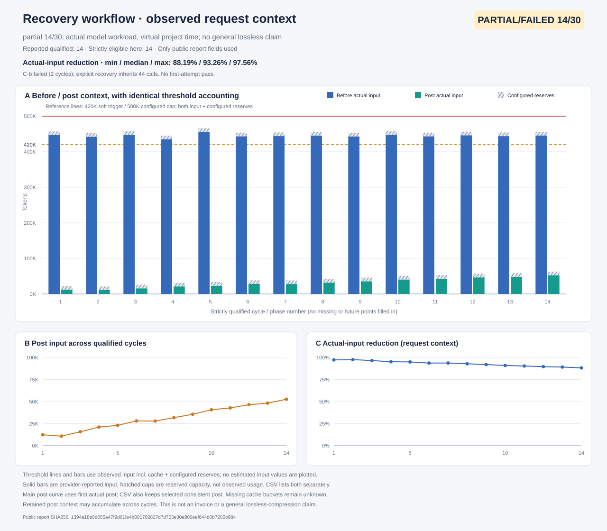

# v0.6.0：协作、证据与长任务恢复（三包正式版）

**14轮合格压缩，压后约65K级（含预留）；测试范围内任务一致性保持，随任务更新持久化项目进度，支持检索与恢复。**

完整 Ultra `0.6.0`、独立 Memory `0.1.0`、独立 Decision `0.1.0` 一起提供。用户选择按当前实测范围收尾发布；**归档长测整体仍为 failed、14/30，原定30轮和一天项目跨度未完成**。正式版标签不改变实验判定，约65K不是固定上限、压缩率或绝对无损承诺。

## 可以做什么

- **完整协作**：保留关闭、Agent＋只读决策辅助、手动2～5路Max研究与decision协调；Team普通子代理提供派发、消息、续作、等待、中断和查询，不自动提高并发。
- **可配置多模型子代理池**：复用DSH模型目录和凭据，按候选ID选模并记录理由、实际provider／模型与工具结果。用户固定选择优先，实例保留创建快照；未知能力不自动视为支持，默认不静默回退。
- **统一decision治理**：可选意图、运行诊断和基于来源的验收，沿用现有decision调用。入队、进入请求和可验证采用分开；模型判断不升级为宿主证明或用户授权。
- **原文证据与进度**：在进展截断前关联稳定来源，增量记录约束、状态、操作、决策替代和冲突；原文检索独立于语义提炼。主题MD为派生视图，原生日志与结构化记录保持权威。
- **按需检索与恢复**：只读search/get、分页／返回预算、精确quote和来源SHA；历史／工具文本不增加权限，同profile知识库须显式项目授权。
- **可选阶段归档**：完整结束、配对平衡的旧阶段使用官方本地模板summary，用户与公开控制文字逐字保留，工具原文留在宿主日志，经`arc_`清单分页恢复。不新增摘要模型、embedding或外部数据库。

实时进度指在宿主允许的事件／后续步骤持续更新已记录状态，区分计划、已执行和已验证；不承诺每条信息都已提炼或模型始终自动采用。必要约束、当前与近期阶段、附件等保护区域可能使其他任务高于目标。

## 三包与安装位置

| 包 | 版本 | 仓库路径 |
| --- | --- | --- |
| `@dsh-external/dsh-ultra-mode` | `0.6.0` | 仓库根目录，保留完整能力 |
| `@dsh-external/dsh-ultra-memory` | `0.1.0` | `packages/dsh-ultra-memory/`，独立证据／上下文／授权知识 |
| `@dsh-external/dsh-ultra-decision` | `0.1.0` | `packages/dsh-ultra-decision/`，普通Team／模型池／只读决策治理 |

可单装或使用Memory＋Decision、Ultra＋Memory。Ultra与Decision同scope只能主动启用一个协调入口；证据配置权威为Memory > Ultra > Decision，授权不并集。根`src/`为共同核心，附属包自包含，默认不新增付费调用。[安装／组合](../companion-plugins.md) · [配置／回滚](../installation.md)。

## 压缩实测的准确范围

官方DSH **0.2.1-rc.2**、OCG **deepseek-v4.1-flash / low**、独立profile、500K总窗口、420K含预留触发。输出预留8,192、后续工具预留2,048，合计10,240。压后取每个合格组首个实际请求，同时另列原判据选取的首个一致分桶请求，缺失cache字段不补零。

| 项目 | 实际结果 |
| --- | --- |
| 严格合格周期 | **14/30**；每个首实际压后含预留均≤130K |
| 14周期压后范围 | **21,033～62,902 token**；第14轮为62,902 |
| 第15阶段 | 11项质量、原文整行取证、持久提交均通过；**不计合格周期** |
| 第15阶段实际压前 | 443,470／433,793输入，含预留为453,710／444,033 |
| 第15阶段实际压后 | **55,424 + 10,240 = 65,664** |
| 停止原因 | 两条压前请求缺`cacheReadTokens`，既定分桶一致性判据为unknown；没有改阈值或追认通过 |
| 原生用量核对 | **239/239请求**；原44＋恢复195，继承前缀只计一次；无未知失败用量或500K越界 |
| 控制器／wrapper累计 | **43.37／43.76分钟**，计时范围不同，不相加 |
| 虚拟项目跨度 | 合格阶段至**10小时50分**；已提交第15阶段至**11小时40分**，未到一天 |

在已测阶段，早期一次性限制、后续要求、决策替代、已执行操作不重做和未解决冲突的固定检查通过。原C-b在阶段3因JSON围栏后的额外文字失败；同会话只读格式恢复只新增1个请求，未重做测试／提交。之后本恢复组在阶段15因上述测量门槛失败，两个失败都保留。

检索与提交范围有**37次工具拒绝**：返回预算21、引文范围8、整行证据不足8。其中29次检索拒绝、8次提交拒绝；模型后续纠正后成功取证，不写成零返工或失败LLM调用。原基线的30轮、旧高效组27轮和本组14轮为不同配置／动态工作量，不能当等工作量费用A/B。额外归档冷读回未prepare／未启动。

固定公开结果、PARTIAL／FAILED曲线、逐轮表和返工窗口见[实验说明](../OCG-EXPERIMENTS.md)、[效率说明](../experiments/compression-efficiency.zh.md)与[原验收规范](../experiments/workflow-500k-30-spec.zh.md)。不将预备维护事件数量当合格周期；附表保留其实际首请求，包括尚带完整大报告的中间状态。

## 分层验证与来源

本轮正式源码构建与服务端／客户端类型检查通过。官方0.2.1-rc.2全套为**727项：725通过、2跳过、0失败**；旧0.2.0-rc.2为**706通过、21跳过、0失败**。新线2项跳过为Windows链接创建权限，旧线另有19项0.2.1专用契约跳过；跳过不算通过，两套不相加。

发布条件还包括：最终三个TGZ逐文件对照真实被测候选、重新运行三包独立／组合原生宿主矩阵，并校验权限、取消和收尾。**正式TGZ的最终原生矩阵、准确计数、哈希及源码对照以Release包外验证附件为准**。包内说明不嵌入自己的最终哈希，避免循环改包；脚本模型验证不冒充真实模型长期效果。

真实归档使用开发候选SHA `bf1235637d999d50421d33107a23ce61958652e1b385461c7caff121247f1092`。正式包仅在核对服务器核心字节后关联该结果，不宣称改号后又跑过239请求。新增客户端修复单独验证：详情鼠标展开保留焦点、Space／Escape／Tab正常、本地化插件用`translate=no`保护模型／恢复ID，不修改浏览器偏好。官方Web＋实际Chrome离线界面**12通过、1不适用**，显式合成状态、0模型调用；最终客户端字节与实测修复版核对。

旧0.2.0-rc.2仅列原模式／SDK及原生离线回归；全局知识需要原生`profileContext.dir`，归档完整实测目标为0.2.1-rc.2。运行时能力校验不等同版本号检测。当前桌面0.1.2-alpha.1低于支持范围；本轮没有安装或修改日常环境。

未验证：完整30轮／一天归档一致性、额外归档冷读回、真实墙钟24h耐久、任意业务／模型无漂移、完整Electron、窄屏像素／鼠标、经Web执行在线模型、掉电级目录持久性。未执行的项目不从mock通过外推。

## 升级与回滚

结束任务、完整退出目标profile，保留旧TGZ、配置、锁文件、原生日志和项目证据。安装同一Release三包中需要的TGZ，保留原bundle列表。压缩、归档和全局知识默认关闭；开启后在后续安全步骤自动处理，不修改已经发出的请求。配置示例见[安装指南](../installation.md#完整旧阶段归档与-130k-验收配置)。

归档提交后若持久化不确定，会暂停后续模型／业务调用，不能虚称精确回滚。已有`arc_`会话必须保留兼容读取器、证据服务、授权的`ultra_memory_get`、至少1,024字符读取预算、完整日志和`.dsh-ultra/v1/archives/`。关闭新建不删除既有恢复入口；不理解归档的旧版不能直接续作，不能删除清单或重做已完成操作来回滚。

[正式Release与三包](https://github.com/Kayou-31/dsh-ultra-mode/releases/tag/v0.6.0) · [SHA256SUMS](https://github.com/Kayou-31/dsh-ultra-mode/releases/download/v0.6.0/SHA256SUMS.txt) · [源码ZIP](https://github.com/Kayou-31/dsh-ultra-mode/releases/download/v0.6.0/dsh-ultra-mode-0.6.0-source.zip) · [白名单验证附件](https://github.com/Kayou-31/dsh-ultra-mode/releases/download/v0.6.0/dsh-ultra-mode-0.6.0-verification.zip)。不含原始私有会话、reasoning、凭据或整个测试profile；公开工具和汇总不能独立重放未分发的同一在线日志，可用自有授权通道重跑实验协议。
