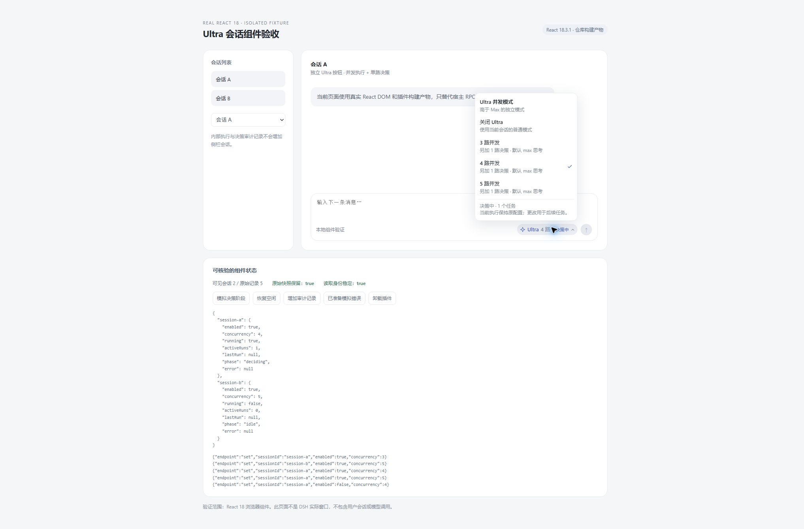

# 0.2.0 验证记录

日期：2026-10-11。目标：实际安装的 DSH Desktop / Host 0.2.0-rc.2、React 18 客户端；旧 0.1.x 插件配置已替换。

## 已通过的检查

- Node 24.18.0：独立目录 `npm ci --ignore-scripts --legacy-peer-deps`、host/client 构建、两套严格 TypeScript 检查通过。
- `npm test`：59 / 59，无失败或跳过。测试为策略、编排、host入口与状态fixture、客户端生命周期与会话列表桥、Jev协议测试。
- 从本机 app.asar 提取的实际 DSH 0.2.0-rc.2 编译后服务：真实 Cordis scope、preset、AgentRegistry、AgentLoop、SessionStore/projection、ToolRuntime、原生 subagent provider、SandboxPolicy、Approval 和 UserQuestion 协同 smoke。

| native 执行路数 | 独立 loop 总数 | 实际普通子代理数 | 并发模型 fixture 请求峰值 | 完成后活跃内部循环 |
| ---: | ---: | ---: | ---: | ---: |
| 3 | 4 | 3 | 3 | 0 |
| 4 | 5 | 4 | 4 | 0 |
| 5 | 6 | 5 | 5 | 0 |

每组的 decision 是同一个独立 loop，先规划，再收到分支证据后实施；所有请求的实际 dispatch 均为 Max，继承宿主 preset。worker 不是 subagent origin，普通子代理仍为 depth=1。研究 worker/后代模拟写入被拒，decision 收敛阶段执行一次模拟写入。

另通过 native 运行中取消、preset ptc/both、native preset+父scope单独ptc/both、PTC取消，共 9 组场景。研究阶段实际 schemas 暴露 native read/subagent 且不含 run_code；PTC prompt sections 为空。decision 恢复父有效呈现后使用真实 run_code bridge 进行脚本化 provider 的嵌套工具分发。没有执行模型生成的 JavaScript。

真实审批服务由主会话 scoped answerer 处理，审计仍保留调用路线身份；实际 timed 人机问题服务通过主会话身份被接受。Ultra 完成后主会话再次写入被拒，下一用户轮次普通工具恢复。PTC 子代理活跃时卸载插件也通过：约 6ms 收敛，RPC 移除，内部 Agent 和 Session 零残留。

这些 fixture 记录摘要保存在 [host-smoke-summary.json](host-smoke-summary.json)。真实 loop 和 provider 的运行证据不等于真实模型推理或文件改动质量证据。

## 浏览器组件实测

使用实际发布的 `lib/client.js`、真实 React/ReactDOM 18.3.1 和独立 Chrome fixture，实际点击验证 A/B 会话隔离、3/4/5 选择、保存失败回滚、关闭再开启、决策阶段状态、内部路线列表过滤与卸载恢复。DOM 中滑轨和 canvas 均为 0，按钮高 28px、菜单圆角 12px、菜单位于按钮上方；控制台无 warning/error。

[浏览器实测 JSON](ultra-react18-fixture-evidence.json)。测试 tab 和服务均已关闭。

## 尚未完成的检查

- 原生 DSH 窗口验收：Windows computer-use 工具在打开实际应用时返回 `product policy blocks this app`。没有绕过该拒绝，也不宣称已在该窗口中实测按钮。
- 真实模型 API 的端到端多路请求与模型输出质量。
- Jev 真实服务：无实际密钥，adapter 使用离线官方协议响应验证；开启与缺密钥的明确降级路径通过。
- 长时间任务、极大上下文、连续大量会话以及宿主未来版本兼容性。

发布包含源码与编译产物，不包含用户 profile、登录数据、密钥、旧 DSH 运行库副本或个人会话日志。不能把离线 smoke 称为以上未完成检查的替代证明。

